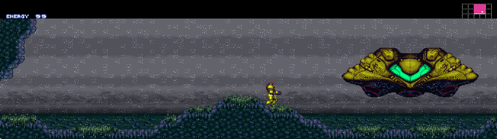
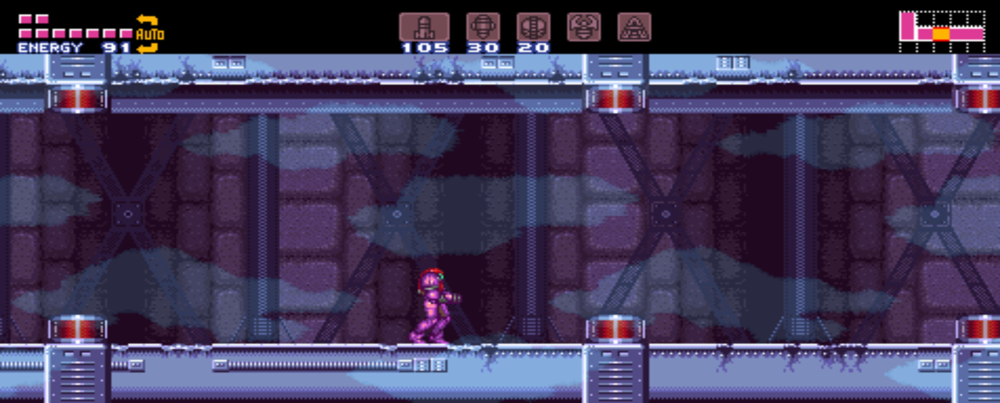

# Super Metroid — PS Vita port (Slopified)

A **PS Vita port** of [mstan's SuperMetroidRecomp](https://github.com/mstan/SuperMetroidRecomp).
**All credit goes to the original authors** — see [CREDITS.md](CREDITS.md). All I did was port it.

## Quick Start

- **Download:** [downloads/SuperMetroid-Vita-r18.vpk](downloads/SuperMetroid-Vita-r18.vpk) (install with VitaShell).
- **ROM:** You need your own legally-dumped `Super Metroid (Japan, USA) (En,Ja).sfc`, placed in `ux0:data/SuperMetroidRecomp/` on your Vita.
- **Build from source:** See [SETUP.md](SETUP.md) for complete build instructions on Windows with WSL.
- Vita controls/extras: Start skips the new-game intro; double-tap the left half of the touch screen toggles 16:9;
  double-tap the right half toggles infinite energy. Saves are written right after the game saves.
- Non-commercial use only (PolyForm Noncommercial 1.0.0, see [LICENSE](LICENSE)).

---

# SuperMetroidSNESRecomp

## Windows frame composition

The pinned shared framework uses cached HLE frame composition by default on
Windows x64. This host presentation optimization is separate from the guest
CPU's LLE scheduler and optional game-routine HLE described below. The existing
CPU, audio and status interfaces remain intact. Build the maintained
correctness-reference compositor separately with
`cmake -S . -B build-frame-lle -DCMAKE_BUILD_TYPE=Release -DSNESRECOMP_FRAME_IMPL=LLE`,
then `cmake --build build-frame-lle`. Selection is fixed at build time.
LLE can reduce performance; it remains available for correctness checks. Other
platforms keep LLE defaults, and existing CMake cache selections are preserved.
See [HLE defaults and opt-out](snesrecomp/docs/HLE_DEFAULTS.md).

The reviewed native-view, uncapped Windows route measured 427.737 to 1259.308 FPS
(+194.41%, process CPU -66.67%); it includes boot/menu work and natural demo play.
The owner accepted the normal-paced adaptive HLE build. These figures describe
that measured build/route, not a new measurement of later upstream title changes
or other platforms. Foreign compiler activity limits precision. Normal play
retains normal pacing/audio. See the shared framework's
[frame model](snesrecomp/docs/FRAME_MODEL_HOSTS.md).

LLE-first recompilation of *Super Metroid* (SNES) into native C, using the
[snesrecomp](https://github.com/mstan/snesrecomp) framework. This repo
is the per-game side: the single-fiber runtime, the per-game `.cfg`, the
build glue, and optional HLE optimizations. The recompiled C output
(`src/gen/`, ~93 MB) is generated locally and is **not** committed.

This is game **#4** on snesrecomp, after Mega Man X, Super Mario World,
and The Legend of Zelda: A Link to the Past.

## What "static recompilation" means here

The ROM and interpreter are the architectural ground truth. Proven hot 65816
functions may be statically translated to C, while every absent or rejected
exact M/X variant executes the original ROM through LLE. HLE is an optional
optimization over that model. **The rest of the SNES is not recompiled** —
it's hardware: PPU rendering, the APU/SPC700 audio coprocessor, DMA and
HDMA channels, hardware register I/O, and bank-mapping all run through
the embedded SNES emulation in `snesrecomp/runner/src/snes/`. Recompile
the CPU, emulate the silicon.

The default LLE scheduler executes the real `WaitForNMI` loop and resumes at
its architectural continuation. Optional HLE mode replaces that wait with a
host-fiber yield for performance.

The ROM is **never** redistributed — you supply your own legally-dumped
copy.

## Current status

The default LLE-first build boots, renders, plays audio, completes the attract
demo, starts a new game, traverses doors, pauses, and saves at Samus's ship.
It remains a work in progress and needs broader end-to-end regression testing.

## Screenshots

Custom widescreen at the landing site, with energy and the minimap anchored
to the outer edges:



Tourian gameplay with energy and reserves on the left, weapons centered,
and the minimap on the right:



Screenshots supplied by the project owner from the custom-renderer build.

## Releases

Download the precompiled ZIP for Windows x64, Linux x64, macOS arm64 or macOS
x64 from this repository's Releases page. Extract the entire folder and start
the executable (on Linux, start `Launch.sh`). Select your own unmodified Super
Metroid (Japan, USA) ROM and play. No compiler, Python, Rust, CMake, source or
toolchain download is needed. No ROM or saved progress is included.

Open **Mods** in the launcher to enable **Widescreen** (Fit, 16:9, 21:9 or 32:9)
and choose edge-anchored or centered HUD placement. **Presentation FPS** is a
separate mod with Auto and fixed frame-rate targets. Both are off by default;
turning both off uses stock rendering. Game logic retains its native timing.
These features are experimental: full-game visual fidelity is not certified,
and achievable FPS depends on hardware and the scene.

Settings and saves live beside the executable. Keep that directory
writable, and preserve your settings and `saves/` when updating. The detailed
implementation and validation record is in `docs/custom-renderer.md`.
The release procedure and profile are documented in `docs/precompiled-releases.md`.
Host snapshots require matching runtime builds; use guest SRAM when upgrading.

## Building from source

Prerequisites: a `snesrecomp` checkout at `./snesrecomp` (junction/symlink
to the sibling repo, pinned in `framework_pins.txt`), a verified Super Metroid
ROM at the repo root, SDL3 + OpenGL, and the mingw64 toolchain (cmake,
gcc, ninja) on `PATH`. Regeneration also requires `rustup` and the native
analyzer. `profiles/release.json` records the shared release generation recipe.

```sh
# 1. (once) clone the snesrev/sm decomp as the symbol/oracle reference
#    (commit pinned in refs/snesrev-sm.pin), then ingest its symbols:
git clone --depth 1 https://github.com/snesrev/sm.git refs/snesrev-sm
python tools/ingest_sm_decomp.py   # funcs -> recomp/*.cfg; tables -> recomp/sm_decomp_symbols.json

# 2. deterministic profile-scoped regeneration (no guest widescreen hooks). Strict mode
#    independently regenerates and requires byte-identical output.
./tools/regen.sh --strict-idempotent

# 3. configure + build
cmake -G Ninja -B build -S . -DCMAKE_BUILD_TYPE=Debug -DCMAKE_C_COMPILER=gcc
cmake --build build -j 8

# 4. run (supply your own ROM)
./build/SuperMetroidSNESRecomp.exe "Super Metroid (Japan, USA) (En,Ja).sfc"
```

## Scripted progression QA

`tools/sm_progression_qa.py` drives a trace-enabled desktop build through the
local debug protocol. It uses private settings and saves, keeps audio emulation
enabled with muted output, journals controller inputs and memory writes, and
captures screenshots, WRAM and state at each waypoint. The supplied ROM is
verified and never modified. Python 3.10 or newer is required.

Configure the build with `-DSNESRECOMP_ENABLE_TRACE=ON`, regenerate the C from
the current `recomp/` directives, then run, for example:

```sh
python tools/sm_progression_qa.py --exe build/SuperMetroidSNESRecomp.exe \
  --rom "Super Metroid (Japan, USA) (En,Ja).sfc" \
  --output _qa/equipment --landing-probe --equipment-route \
  --invincible --assist-pickups --save-each-room --station-probe
```

Room jumps use the ROM's door loader, including room-state selection, graphics,
enemies, PLMs and room ASM. Samus walks briefly after each entry. Item tests
try movement and shooting, then optionally inject a contact/shot marker into
the active item PLM; the ROM applies inventory changes and messages. The tool
waits through the message's reading delay before attempting another door.
The route was informed by the [MarcusRaven86 walkthrough](https://gamefaqs.gamespot.com/snes/588741-super-metroid/faqs/75189/down-to-brinstar)
and checked against [sm-json-data](https://github.com/vg-json-data/sm-json-data).
Room and item objects are discovered from the supplied ROM and live RAM;
neither dataset is required to run the tool.

Use `--sweep` for every accessible Zebes room, `--rooms 957d df1b` for specific
hexadecimal room headers, and `--post-boss` to inspect alternate room states.
Use `--boss-assist --boss-phase` with boss-room targets to accelerate damage
and allow explicit death-phase injection for Kraid, Phantoon and Ridley. Boss
completion requires the ROM to set a boss flag. Directly injected boss flags
in `--post-boss` are diagnostic state setup, not evidence of a boss victory.

Each output directory must be new. `report.json` records executable/ROM hashes,
options, transitions, pickup outcomes, boss assistance and failures. Unverified
pickups and uncleared bosses remain visible in the report. `--save-each-room`
retains host checkpoints for `--seed-state`; `--seed-sram` copies guest SRAM
before launch and starts it through the normal menus. `--save-probe` poisons
health after saving, reloads it, then checks that input advances the game.
Raw `.l3sn` hardware dumps are diagnostic artifacts; use `.sav` checkpoints
to restore the port's execution continuation.

The October 2026 pass entered 255 accessible Zebes rooms plus all six Ceres
rooms, exercised equipment pickups and real save-station SRAM, and compared
the Crab Maze failure against interpreter-only execution. Default LLE fixes
cover item-message yielding, an inline-argument HDMA wrapper, the compiled
enemy slope helper, and host snapshots loaded in a fresh process. The fixes
use existing portable interpreter/runtime interfaces. File continuations
require matching runtime builds; legacy snapshots and suspended HLE native
fibers retain their prior limitations.

Injected doors bypass traversal requirements, and test-only control-lock
normalization follows forced elevator entries. Room visits therefore establish
loader/frame coverage, not an unassisted playthrough or full-room collision
coverage. Mother Brain, the final escape and credits remain unvalidated.

## Layout

| Path | What |
| --- | --- |
| `src/` | hand-written runtime: `sm_rtl.c` (single-fiber frame driver), `sm_cpu_infra.c`, `sm_spc_player.c`, `gen_stubs.c` (HLE bodies), `main.c`, `post_mortem.c` |
| `src/gen/` | generated recompiled C (not committed) |
| `recomp/` | per-bank `.cfg` (function boundaries, HLE/dispatch directives) + generated `funcs.h` |
| `snesrecomp/` | junction to the shared framework repo (tracked there; see `snesrecomp.pin`) |
| `tools/` | per-game helpers |

---

<p align="center">
  <sub><b>R.A.I.D. — Retro AI Development</b> · a Discord for AI-assisted retro reverse-engineering, decomp &amp; recomp</sub>
</p>

<p align="center">
  <a href="https://discord.gg/Ad9BwSzctP"></a>
</p>

## License

PolyForm Noncommercial 1.0.0. See `LICENSE`. Code in this repo is original;
vendored dependencies under `third_party/` retain their own licenses.

The game ROM and any data extracted from it are **not** in this repo and are
not licensed for redistribution.
